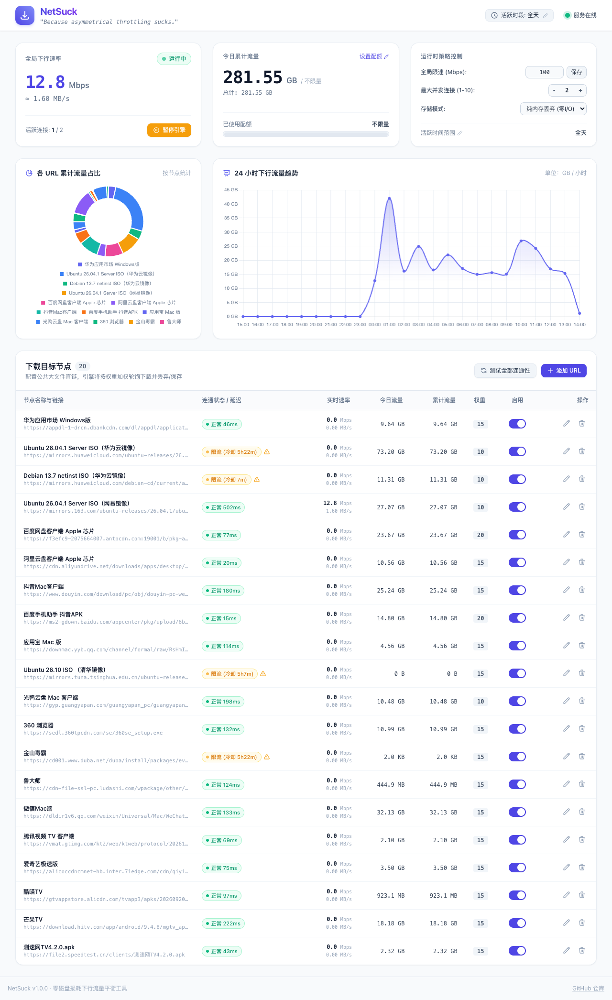

# NetSuck

> **Because asymmetrical throttling sucks.**
> 专为 NAS / 家用服务器打造的轻量级、零硬盘损耗 HTTP/HTTPS 下行流量生成与上下行带宽平衡工具。

[](https://github.com/StromKuo/NetSuck/pkgs/container/netsuck)
[](LICENSE)
[](https://go.dev/)

---

## 📖 项目背景与原理

### 为什么需要 NetSuck？
在家庭宽带环境中，不少用户部署了 NAS、私人云盘、远程备份或 PT/BT 下载等服务，上行带宽使用频率较高。然而，部分宽带运营商部署了严格的流量监控策略：**当用户的上下行流量比例严重失衡（如上行远高于下行，呈现出显著的对等或倒挂特征）时，极易被局端算法判定为 PCDN 异常或商业违规行为**，进而遭遇限速、QoS 降级甚至宽带被停等风控处置。

**NetSuck** 应运而生。它通过安全、合规的方式，从公开大文件直链（如各大高校与云厂商的开源镜像站 ISO 文件、公共测速包等）持续、受控地产生真实下行 HTTP/HTTPS 流量，平稳拉高下行总吞吐，将上下行比例恢复至正常家庭宽带特征区间，从而有效规避局端的不对称限速风控。

### 核心设计：零磁盘丢弃（Zero Disk I/O）
常规下载工具（如 Aria2、wget、BT 客户端等）在拉取文件时通常必须写入本地磁盘，若以 100~300 Mbps 的速率全天候刷流，每日将产生数百 GB 乃至数 TB 的海量写入，会急剧消耗 SSD 闪存寿命，或导致机械硬盘高负载寻道、发热及噪音。

NetSuck 采用基于 Go 原生 `net/http` 定制的流式引擎：
- **默认 `discard` 模式**：通过固定的 32KB 极小循环缓冲区从网卡读取数据流，通过原子操作（`sync/atomic`）完成字节级统计后，直接交由 `io.Discard` 丢弃。
- **真正零磁盘 I/O**：全过程无需任何磁盘读写（仅每 10 秒向 SQLite 异步写入极少量的聚合流量统计数据）。
- **极低资源开销**：常驻物理内存占用极低（RSS 稳定在 30MB 以内），CPU 占用微乎其微。

---

## ✨ 核心特性

- **🛡️ 家用网络与 NAT 表保护**：
  - 默认仅维持 **2 个并发连接**（可调范围 1-10），配合高速 CDN 单连接即可轻松跑满 100~300 Mbps 带宽。
  - **单域名/单 URL 严格限制 1 条活跃连接**，并复用全局 HTTP 连接池（`http.Transport`），杜绝短连接频繁断开与大量 `TIME_WAIT` 会话残留，避免拖垮家用光猫与路由器的 NAT 连接跟踪表（Conntrack）。
- **⚡ 令牌桶平滑限速与热修改**：
  - 基于高精度令牌桶限速器（`rate.Limiter`）实现全局下行带宽精准控制。
  - 支持在 Web 面板实时动态调节带宽上限（单位 Mbps，设为 `0` 即不限速），调整后立即生效，无需重启容器。
- **⏱️ 每日配额与活跃时段调度**：
  - 可配置每日流量配额（单位 GB，设为 `0` 即不限量），达到配额后自动休眠，次日 00:00（遵循系统时区 `TZ`）自动重置。
  - 支持活跃时间段设置（如仅在凌晨或工作时间运行以避开晚高峰，支持跨夜时段配置）。
- **🛑 智能防风控与自动冷却机制**：
  - **403 / 429 自动冷却**：一旦目标返回 403 Forbidden 或 429 Too Many Requests，系统自动对该节点触发长达 **6 小时**的冷却期，冷却期间调度器与探活均杜绝发起请求，避免公网 IP 被拉黑。
  - **连续错误熔断**：单节点连续 3 次遇到网络超时或 404/5xx 错误时自动熔断为 `Dead`，等待后续探活恢复。
  - **随机 Jitter 休眠**：每次文件下载完成后在指定区间内随机休眠，使流量曲线呈现自然波动特征。
- **🔍 自动化健康探活**：
  - 每 15 分钟（或在面板手动触发）向各目标发送轻量 `Range: bytes=0-1023` 请求进行延迟与可用性探活，状态实时回显。
- **📊 响应式单文件 Web 面板**：
  - 前端通过 Go `//go:embed` 完整打包入单文件，无外部 Node.js 构建链路。
  - 提供暗色/亮色自适应界面，包含实时速率表盘、每日配额进度条、节点健康指示灯、24 小时流量趋势折线图与节点占比环形图，并支持所有配置的热更新与节点的增删改查。
- **🔄 软删除与 URL 重加机制**：
  - 节点删除采用软删除（标记 `deleted_at`），保留历史统计与图表数据；依托数据库局部唯一索引，同一 URL 删除后支持重新添加并以全新 ID 独立记账。
- **📦 多架构原生镜像**：
  - 静态编译无 CGO 依赖，官方发布支持 `linux/amd64` 与 `linux/arm64` 平台 Docker 镜像。

---

## 🚀 快速部署

### 方式一：使用 Docker Compose 部署（推荐）

在宿主机上创建目录（如 `netsuck`），并在其中保存以下 `docker-compose.yml` 文件：

```yaml
services:
  netsuck:
    image: ghcr.io/stromkuo/netsuck:latest
    container_name: netsuck
    restart: unless-stopped
    ports:
      - "8080:8080"
    volumes:
      # 持久化目录：用于存放运行时生成的 config.yaml 与 SQLite 统计数据库 stats.db
      - ./data:/data
    # 可选 tmpfs 内存盘配置（仅在使用 storage_mode: memory 模式时需要）：
    # 【特别注意】：若启用 memory 模式，必须为 tmpfs 显式设置大小上限（如 size=2g），
    # 避免持续下载打满主机物理内存触发 OOM！默认 discard 模式无需开启此段。
    # tmpfs:
    #   - /tmp/dl_cache:size=2g
    environment:
      # 时区配置：影响每日配额重置时间（00:00）以及活跃时间段判定
      - TZ=Asia/Shanghai
```

执行启动命令：
```bash
docker compose up -d
```

启动完成后，打开浏览器访问 `http://<你的NAS或服务器IP>:8080` 即可进入 Web 控制面板。首次启动时，程序会自动在 `./data/` 目录下生成默认配置文件 `config.yaml`（内置经过实测的 10+ 条分散大文件节点）并初始化 SQLite 数据库。

### 方式二：Docker CLI 直接运行

```bash
docker run -d \
  --name netsuck \
  --restart unless-stopped \
  -p 8080:8080 \
  -v $(pwd)/data:/data \
  -e TZ=Asia/Shanghai \
  ghcr.io/stromkuo/netsuck:latest
```

---

## ⚙️ 完整配置项说明

程序配置文件默认为 `/data/config.yaml`（首次启动自动由预置模板生成）。所有配置项及其含义如下：

| 配置项 | 类型 | 默认值 | 允许范围 / 格式 | 说明 |
| :--- | :--- | :--- | :--- | :--- |
| `listen_addr` | string | `":8080"` | `host:port` | Web 管理面板及 API 的 HTTP 监听地址与端口。 |
| `storage_mode` | string | `"discard"` | `discard` \| `memory` \| `disk` | **数据存储模式**：<br>• `discard`（推荐）：内存极小缓冲丢弃，零磁盘 I/O，内存稳定 < 30MB；<br>• `memory`：写入 `memory_dir` 并在单文件下载后立即删除（容器内建议挂载上限 tmpfs）；<br>• `disk`：落盘至 `disk_dir` 保存。 |
| `memory_dir` | string | `"/tmp/dl_cache"` | 有效目录路径 | `memory` 模式下的临时文件存放目录。 |
| `disk_dir` | string | `"/data/downloads"`| 有效目录路径 | `disk` 模式下的持久化下载目录。 |
| `max_rate_mbps` | int | `100`（默认模板）<br>`0`（未配置时缺省） | `>= 0` | **全局最大下行限速（Mbps）**。<br>• 设为 `0` 表示**不限速**（全速运行）；<br>• 支持在 Web 面板中随时热调整并实时生效。 |
| `max_connections` | int | `2` | `1` ~ `10` | **全局最大并发下载连接数**。<br>严格限制整个系统同一时刻允许拉取数据的连接总数。支持在 Web 面板动态增减。 |
| `daily_limit_gb` | float | `300`（默认模板）<br>`0`（未配置时缺省） | `>= 0` | **每日流量配额上限（GB）**。<br>按十进制换算（1 GB = 10^9 字节）。<br>• 设为 `0` 表示**不限量**；<br>• 达到上限后引擎自动休眠，次日当地时间 00:00 自动清零恢复。 |
| `schedule.start_hour` | int | `0` | `0` ~ `23` | **活跃时间段起始小时（包含）**。 |
| `schedule.end_hour` | int | `24` | `0` ~ `24` | **活跃时间段结束小时（不包含）**。<br>`24` 代表当日午夜（24:00）。<br>• 起止不同日（跨夜）时，如 `start: 23, end: 7` 表示 23:00 至次日 06:59 活跃；<br>• `start_hour == end_hour` 视为非法配置。 |
| `jitter_seconds.min_seconds` | int | `5` | `>= 0` 且 `<= max` | 单文件下载完成后的**最小随机休眠秒数**。 |
| `jitter_seconds.max_seconds` | int | `30` | `>= min` | 单文件下载完成后的**最大随机休眠秒数**。让流量曲线呈现自然起伏。 |
| `cooldown_hours` | int | `6` | `> 0` | **限流冷却时长（小时）**。<br>当节点遇到 403 或 429 响应时，自动冷冻的时长。冷冻期间绝不发起请求。 |
| `user_agent` | string | Chrome UA | 字符串 | 发起 HTTP 请求所使用的 `User-Agent` 请求头。默认模拟桌面版主流 Chrome 浏览器，规避非浏览器 UA 拦截。 |
| `targets` | array | 见模板 | 对象列表 | **下载目标列表**，具体节点结构见下表。 |

### `targets` 节点字段说明

| 字段 | 类型 | 默认值 | 必填 | 说明 |
| :--- | :--- | :--- | :--- | :--- |
| `name` | string | - | 是 | 节点显示名称（用于在 Web 监控面板与图表中标识展示）。 |
| `url` | string | - | 是 | 公开下载直链。必须为 `http://` 或 `https://`，且**不得包含账号密码（userinfo）**。 |
| `weight` | int | `10` | 否 | **调度加权权重**（必须 `>= 1`）。数值越高，在加权轮询调度中被选中的概率越高。 |
| `enabled` | bool | `true` | 否 | 节点启用开关。设为 `false` 则保留该节点但不参与调度与下载。 |

> **提示**：配置文件采用宽松加载与严格校验机制。配置文件中未填写的字段将自动应用上述默认值；若显式指定了 `0` 或 `false`，程序会忠实保留该设定（如 `max_rate_mbps: 0` 严格代表不限速，不会被覆盖为默认值）。

---

## 🌐 网络调优与防护原理

### 1. 限速建议：宽带下行的 10% ~ 30%
家庭宽带的主要功能是满足日常家庭用网（视频通话、4K 流媒体播放、在线游戏等）。因此：
- 建议将 `max_rate_mbps` 设置为物理签约下行带宽的 **10% ~ 30%**。例如：1000M 宽带设置 100 ~ 200 Mbps，500M 宽带设置 50 ~ 100 Mbps。
- 这样既能稳定产生足够的下行吞吐平衡流量比例，又为家庭成员留出了 70% 以上的充裕带宽余量，避免出现测速抢带宽或日常上网卡顿。

### 2. 为何并发连接数 `max_connections` 默认仅为 2？
很多网络工具默认采用 8、16 甚至更高并发，但这在家庭网络环境中往往带来严重负面影响：
1. **跑满带宽并不需要高并发**：主流云厂商与高校开源镜像站均具备充足带宽，单条 CDN TCP 连接在稳定状态下往往能达到 50~150 Mbps。仅需 2~3 条并发连接即可轻松跑满 100~300 Mbps 的预期总速率。
2. **光猫 NAT 连接跟踪表（Conntrack）保护**：家用光猫与低端路由器的 NAT 表容量通常非常有限（几千至一万多条）。过高的并发下载与反复重试会迅速挤满 NAT 会话表，导致全家所有设备出现解析延迟激增、微信发不出图片、网页打不开甚至光猫死机。NetSuck 严格将并发控制在极小范围，彻底根除此隐患。

### 3. 单域名互斥与 HTTP 连接池复用
- **单域名硬互斥（`per_host_connections: 1`）**：同一时刻对同一个域名/Host 最多仅允许建立 1 条活跃下载连接。杜绝多线程同时压榨同一 CDN 节点触发其 IP 限流风控。
- **底层连接池复用**：全局复用调优后的单一 `http.Client` 实例，长连接空闲保活超时（`IdleConnTimeout`）设为 90 秒，避免产生大量 `TIME_WAIT` 状态连接。

### 4. 403 / 429 智能长冷却与防风控熔断
- **403/429 长冷却**：公网 CDN 或镜像站在遭遇频繁请求时可能返回 HTTP 403 或 429。普通工具若持续死循环重试，会导致整段公网 IP 被 CDN 提供商防火墙永久拉黑。NetSuck 一旦捕获 403 或 429，立即将节点标记为 `RateLimited` 并进入长达 **6 小时**的完全冷却期，期间任何例行下载和探活均禁止向该域名发包。
- **连续 3 次错误熔断**：若节点遇到超时、网络重置或 404/5xx，连续累计 3 次后自动置为 `Dead`（失效），调度器自动跳过该节点，直到下一次定时探活（15 分钟）检测其恢复正常后才重新启用。
- **大文件偏好与加权 Jitter**：内置模板均优选 GB 级别官方 ISO 镜像或大体积安装包，单次下载可持续数分钟至数十分钟，结合随机休眠，整体 HTTP 请求频次（QPS）极低，流量特征与真实用户无异。

---

## 🖥️ Web 监控面板功能



NetSuck 内置单文件响应式 Web 仪表盘，无需安装额外插件即可在手机或桌面浏览器上舒适操作：

1. **核心概览卡片**：
   - **全局实时速率**：动态展示当前全局下行速率（同步显示 Mbps 与 MB/s），带有平滑过渡效果及一键“暂停 / 恢复”开关。
   - **今日流量配额**：直观展示今日累计已刷流量与设定每日配额上限的完成进度（点击即可快捷修改每日配额）。
   - **运行策略控制**：支持直接在页面上调整**全局限速（Mbps）**、**最大并发数（1-10）**及**存储/丢弃模式**，保存后实时生效。
2. **节点列表明细与管理**：
   - 展示所有 URL 节点的实时下载速度、今日已刷流量、历史累计流量、响应延迟及调度权重。
   - 带有**连通状态指示灯**：绿色正常（Healthy）、黄色冷却中（RateLimited，悬停可查看剩余冷却时间）、红色失效（Dead，悬停可查看错误详情）、灰色未探活（Unknown）。
   - 支持在网页上一键**添加新 URL 节点**、**编辑/启用/禁用节点**、**删除节点**，以及**一键测试所有节点连通性**。
3. **可视化数据图表**：
   - **24 小时流量趋势折线图**：清晰呈现过去 24 小时内每小时产生的下行流量柱状/折线趋势，便于观察波峰波谷。
   - **各节点贡献占比环形图**：直观展示不同 CDN 或镜像源各自贡献的流量份额比例。

---

## 🛠️ 本地开发与手动运行

若希望在本地直接以源码方式编译运行 NetSuck：

### 环境要求
- Go 1.23 或更高版本

### 1. 编译构建
```bash
# 克隆代码仓库
git clone https://github.com/StromKuo/NetSuck.git
cd NetSuck

# 静态编译二进制
CGO_ENABLED=0 go build -ldflags="-s -w" -trimpath -o netsuck .
```

### 2. 准备配置并运行
程序通过 `-config` 命令行参数指定配置文件路径（默认路径为 `/data/config.yaml`）：

```bash
# 从示例模板复制一份配置文件
mkdir -p ./data
cp config.example.yaml ./data/config.yaml

# 启动程序（指定配置文件）
./netsuck -config ./data/config.yaml
```

启动后控制台将输出启动日志，并在浏览器打开 `http://localhost:8080` 即可访问。

### 3. 软删除 URL 与重新添加语义
在 NetSuck 中，若您在 Web 面板或通过 API 删除了某个 URL 节点：
- 系统在底层采用**软删除（Soft Delete）**机制，仅在 SQLite 数据库中将该记录标记 `deleted_at` 时间戳，**历史统计数据与图表数据均得到完整保留**。
- 数据库底层在 `url` 列上建立了局部唯一索引（`CREATE UNIQUE INDEX ... WHERE deleted_at IS NULL`）。这意味着：**如果您后续希望重新添加此前曾经删除过的相同 URL 直链，系统完全允许并会为其分配全新的 ID 重新开始记账**，绝不会产生主键或唯一性冲突，同时新旧两段周期的历史统计均可独立追溯。

---

## 📄 License

本项目采用 [MIT License](LICENSE) 开源协议授权。
